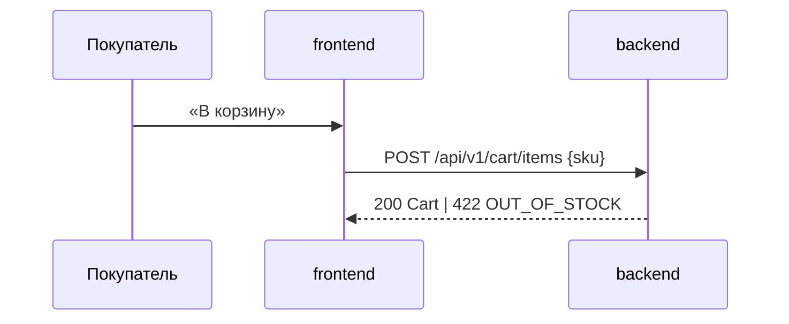

# System requirements

## Компоненты

- `backend`: хранение корзины, проверка остатков, расчёт итога
- `frontend`: экран корзины, кнопка «В корзину»

## Матрица сценариев

| capability/scenario | компоненты | примечание |
|---|---|---|
| `checkout/cart/Товар в наличии` | backend, frontend | |
| `checkout/cart/Товара нет в наличии` | backend, frontend | ошибка `OUT_OF_STOCK` |
| `checkout/cart/Итог без скидки` | backend | frontend только отображает `total` |
| `checkout/cart/Пустая корзина` | backend, frontend | |

## Взаимодействие

## Контракты интеграций

`GET /api/v1/cart`, `POST /api/v1/cart/items` — `contracts/cart.openapi.yaml` 1.0.0.

## Логическая модель данных

Корзина (покупатель, позиции) → позиция (товар, количество, цена на момент добавления).

## Нефункциональные требования

`GET /cart` p95 ≤ 150 мс при 100 RPS.

## Миграция и совместимость

Нет: новая функциональность, существующих данных нет. Выкатка: backend, затем frontend.

## Открытые вопросы

Нет.
