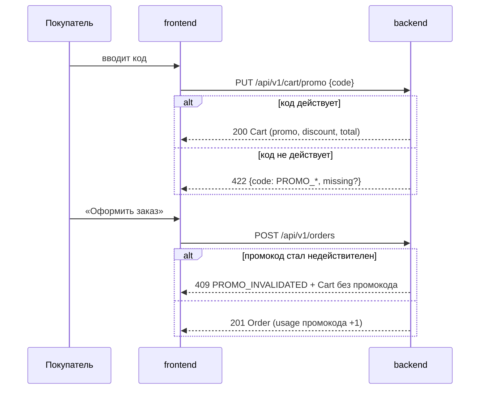

# System requirements

## Компоненты

- `backend`: хранение промокодов, проверка ограничений, расчёт скидки и итога, учёт использований при оформлении заказа
- `frontend`: поле ввода промокода в корзине, отображение скидки, итога и ошибок

## Матрица сценариев

| capability/scenario | компоненты | примечание |
|---|---|---|
| `checkout/promo-codes/Успешное применение` | backend, frontend | |
| `checkout/promo-codes/Неизвестный промокод` | backend, frontend | ошибка `PROMO_NOT_FOUND` |
| `checkout/promo-codes/Истёкший промокод` | backend, frontend | ошибка `PROMO_EXPIRED` |
| `checkout/promo-codes/Не выполнена минимальная сумма` | backend, frontend | `PROMO_MIN_TOTAL`, в ответе `missing` |
| `checkout/promo-codes/Замена промокода` | backend, frontend | `PUT` перезаписывает код |
| `checkout/promo-codes/Удаление промокода` | backend, frontend | |
| `checkout/promo-codes/Лимит использований исчерпан` | backend, frontend | ошибка `PROMO_LIMIT_REACHED` |
| `checkout/cart/Итог без скидки` | backend | без изменений, регрессия |
| `checkout/cart/Пустая корзина` | backend, frontend | без изменений, регрессия |
| `checkout/cart/Итог со скидкой промокода` | backend | frontend только отображает `total` |
| `checkout/cart/Скидка больше суммы корзины` | backend | |
| `integration/promo-apply/Промокод стал недействителен до оформления` | backend, frontend | `409 PROMO_INVALIDATED` на `POST /orders` |
| `integration/promo-apply/Повторный запрос применения` | backend, frontend | `PUT` идемпотентен; frontend блокирует кнопку |

## Взаимодействие

## Контракты интеграций

Полные контракты в папке change, обе версии обратно совместимы с 1.0.0:
`contracts/cart.openapi.yaml` 1.1.0, `contracts/orders.openapi.yaml` 1.1.0.

| Метод | Успех | Ошибки |
|---|---|---|
| `PUT /api/v1/cart/promo` `{code: string}` — новый | `200 Cart` | `422 PROMO_NOT_FOUND / PROMO_EXPIRED / PROMO_MIN_TOTAL / PROMO_LIMIT_REACHED`; `429` без тела, `Retry-After` |
| `DELETE /api/v1/cart/promo` — новый | `200 Cart` | — (нет промокода → тоже `200`) |
| `POST /api/v1/orders` — существующий | `201 Order` | **новая** `409 PROMO_INVALIDATED`, тело `{error, cart}`; `422` как раньше |

- В `Cart` добавлены необязательные поля `promo: {code, kind: percent|fixed, value}` и `discount` (копейки),
  в `Order` — `promo_code` и `discount`.
- Ошибка промокода: `{code, message, missing?}`. `message` — готовый текст для покупателя,
  frontend показывает его как есть. `missing` — копейки до минимальной суммы, только для `PROMO_MIN_TOTAL`.
- Код нормализуется на backend: обрезка пробелов + верхний регистр.
- Идемпотентность: `PUT` и `DELETE` — установка состояния, повтор даёт тот же результат.

## Логическая модель данных

- **Промокод**: код (уникальный), тип скидки (процент / фиксированная сумма), значение, начало и конец действия, минимальная сумма заказа, лимит использований, число использований.
- **Корзина** → 0..1 промокод.
- **Заказ** хранит код и сумму скидки на момент оформления (для отчётов маркетинга).

## Нефункциональные требования

- `PUT /cart/promo`: p95 ≤ 200 мс при 50 RPS.
- Защита от перебора кодов: не более 10 неудачных попыток в минуту на покупателя, дальше `429`.
- Счётчик использований не превышает лимит при параллельных оформлениях заказа.
- Аудит-лог применений и отказов (код, покупатель, причина) хранится 90 дней.

## Миграция и совместимость

1. backend выкатывает новые поля и эндпоинты (frontend старой версии их игнорирует).
2. frontend выкатывает UI за фича-флагом `promo_codes`.
3. Маркетинг заводит первые промокоды через поддержку, флаг включается.

## Открытые вопросы

- ~~Считать ли использованием применение в корзине?~~ Нет, только оформленный заказ (решение БА, 2026-10-05).
