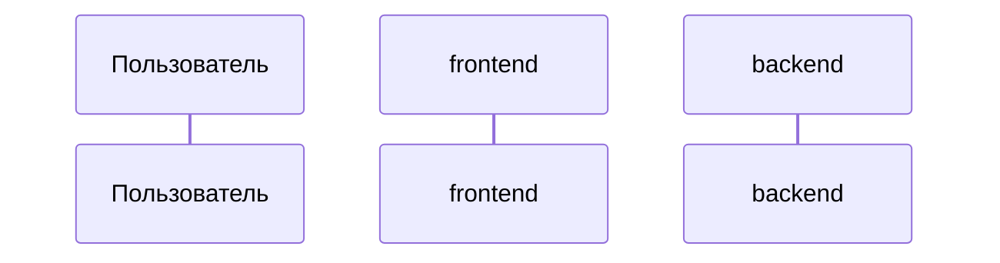

# System requirements

## Компоненты

<!-- id из components.yaml и их ответственность. Формат строк не менять - его читают скилы. -->
- `backend`: <ответственность>
- `frontend`: <ответственность>

## Матрица сценариев

| capability/scenario | компоненты | примечание |
|---|---|---|
| `<domain>/<capability>/<scenario>` | backend, frontend | |

## Взаимодействие

## Контракты интеграций

<!-- метод/путь или топик; поля с типами и обязательностью; ошибки; идемпотентность;
     версионирование. Крупные контракты - contracts/<name>.openapi.yaml в папке change -->

## Логическая модель данных

## Нефункциональные требования

## Миграция и совместимость

## Открытые вопросы
